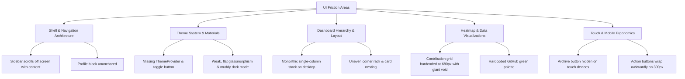

# Focus Tracker (Focus Duo) — UI Audit & Refactor Plan

> **Document Version**: 1.0.0  
> **Status**: Approved for Implementation (Phase UI-0 Audit Complete)  
> **Role Context**: Senior Product Designer, Accessibility Specialist & Senior Frontend Engineer  
> **Core Objective**: Elevate Focus Tracker to a world-class, Apple-grade productivity application through disciplined UI polish, layout refactoring, responsive ergonomics, and fluid motion—**without altering business logic, API schemas, database contracts, or timer state machines.**

---

## 1. Executive Summary & Audit Scope

Focus Tracker is a fully functional, high-integrity personal and small-group productivity tool designed for 2–4 profiles. Its backend engines (timer reconciliation, midnight date-splitting in `Asia/Kolkata`, streak derivation, and idempotent leaderboard snapshots) are 100% verified and pass 89 out of 89 integration tests.

However, the user interface currently suffers from structural layout flaws, layout overcrowding, missing theme controls, and visual inconsistencies that distract from the product's underlying engineering craft.

### Hard Constraints Maintained Throughout This Plan
1. **Zero Business Logic Mutations**: No changes to API routes, payload structures, database migrations, timer calculation math, or authentication security.
2. **Zero Mocking / Fabrication**: Real database values only; no synthetic dummy profiles or fabricated statistics.
3. **Product Integrity**: Preserve the current product identity, route paths (`/dashboard`, `/analytics`, `/leaderboard`, `/login`), and existing working functionality.
4. **Implementation Guardrail**: This document (`PHASE UI-0`) constitutes the complete audit and plan. **No visual implementation changes will begin until this plan is reviewed.**

---

## 2. Current Frontend Architecture & Component Inventory

### 2.1 Tech Stack & Dependencies
- **Framework**: Next.js 16.4.3 (App Router, Turbopack, React 19.3.0)
- **Styling**: Tailwind CSS v4 (`@tailwindcss/turbopack`, `tailwindcss: ^4`) with inline `@theme` variables
- **Component Primitives**: shadcn/ui (`base-nova` style with `@base-ui/react` unstyled primitives)
- **Icons**: Lucide React (`lucide-react: ^1.61.0`, stroke width 1.75–2.0)
- **Data Visualization**: Recharts (`^3.10.1`)
- **Animation**: `tw-animate-css` (`^1.4.0`) + CSS transforms

### 2.2 Route Map
| Route | Access | Primary Purpose | Key Components |
|---|---|---|---|
| `/login` | Public | Name + PIN authentication & profile signup with invite code | Segmented toggle, PIN numeric input, Invite code field |
| `/dashboard` | Authenticated | Central focus workflow & daily accountability | `TimerCard`, `RecentTasks`, `DailySummary`, `ContributionGraph`, `LeaderboardPreview` |
| `/analytics` | Authenticated | Deep focus analysis, streak audits & trends | `RangeSelector`, `AnalyticsSummaryCards`, `FocusTimeChart`, `CompletionsChart`, `CategoryDistributionChart`, session log table |
| `/leaderboard` | Authenticated | Team standings frozen at 10:00, 18:00, 22:00 IST | `LeaderboardTabs`, `LeaderboardStatusBanner`, `StandingsList`, checkpoint info cards |
| `/` | Public | Automatic redirect root | Redirects to `/dashboard` (if authenticated) or `/login` |

### 2.3 Reusable Component Inventory
- **Layout**: `AppShell` (`apps/web/src/components/layout/app-shell.tsx`)
- **Timer Engine UI**: `TimerCard` (`components/timer/timer-card.tsx`), `DecisionDialog` (`components/timer/decision-dialog.tsx`)
- **Task Management**: `RecentTasks` (`components/tasks/recent-tasks.tsx`), `AddTaskDialog` (`components/tasks/add-task-dialog.tsx`)
- **Dashboard Widgets**: `DailySummary` (`components/dashboard/daily-summary.tsx`), `ContributionGraph` (`components/dashboard/contribution-graph.tsx`), `DayDetailDialog` (`components/dashboard/day-detail-dialog.tsx`), `LeaderboardPreview` (`components/dashboard/leaderboard-preview.tsx`)
- **Analytics Widgets**: `RangeSelector`, `AnalyticsSummaryCards`, `FocusTimeChart`, `CompletionsChart`, `CategoryDistributionChart`
- **Leaderboard Widgets**: `LeaderboardTabs`, `LeaderboardStatusBanner`, `StandingsList`
- **Shadcn Primitives**: `avatar`, `badge`, `button`, `dialog`, `dropdown-menu`, `input`, `separator`, `sheet`, `skeleton`, `tooltip`

---

## 3. Comprehensive Audit Findings

Based on inspection of the codebase, component trees, and issues reported by the owner, we have identified 10 critical friction points:



### Finding 1: Unanchored Sidebar & Profile (Scrolling Defect)
- **Location**: `apps/web/src/components/layout/app-shell.tsx` (Lines 104–172)
- **Root Cause**: The layout container uses `<div className="min-h-screen bg-background text-foreground flex flex-col md:flex-row">`, and the desktop sidebar `<aside className="hidden md:flex flex-col w-60 border-r border-border bg-sidebar shrink-0 justify-between select-none">` participates in normal document window scrolling.
- **Symptom**: When the user scrolls down on the Dashboard or Analytics page, the sidebar, brand header, navigation links, and the bottom profile card scroll completely out of view.
- **Expected Apple Pattern**: Stationary macOS-style navigation rail (`sticky top-0 h-screen overflow-y-auto` or fixed rail with independent scroll context for the main canvas). Profile identity and navigation must stay anchored.

### Finding 2: Missing Global Theme Toggle & Incomplete Dark Mode Pipeline
- **Location**: `apps/web/src/app/layout.tsx` & `apps/web/src/app/globals.css`
- **Root Cause**: `layout.tsx` contains only `<AuthProvider>`. There is no theme provider (e.g. `next-themes`), no theme state persistence in `localStorage`, and no toggle control in either the desktop sidebar or the mobile header.
- **Symptom**: Dark mode variables exist in `globals.css` under `.dark`, but users are completely locked into light mode unless they manually edit the DOM.
- **Expected Apple Pattern**: Seamless System / Light / Dark switching with instant class application, zero hydration flicker (`suppressHydrationWarning`), and a refined tactile toggle with sun/moon icons.

### Finding 3: Dashboard Overcrowding & Monolithic Stack
- **Location**: `apps/web/src/app/dashboard/page.tsx` (Lines 201–245)
- **Root Cause**: All 6 dashboard sections (`TimerCard`, `RecentTasks`, `DailySummary`, `ContributionGraph`, `LeaderboardPreview`) are rendered as full-width cards in a single vertical column (`<div className="flex flex-col gap-8 pb-12">`).
- **Symptom**: On desktop (1280px–1440px), the dashboard feels like a never-ending vertical scroll of heavy cards. The timer card stretches too wide, while tasks and metrics are pushed far below the fold.
- **Expected Apple Pattern**: An asymmetric multi-column layout on desktop:
  - **Hero Focus Zone (Left ~60%)**: Hero timer surface + Today's active tasks queue.
  - **Insight & Accountability Rail (Right ~40%)**: Daily progress cards + Checkpoint leaderboard preview.
  - **Full-Width Horizon (Bottom)**: 26-week activity contribution heatmap.

### Finding 4: Badly Sized, Misaligned & Hardcoded Contribution Graph
- **Location**: `apps/web/src/components/dashboard/contribution-graph.tsx` (Lines 153–206)
- **Root Cause**:
  - The grid is wrapped in `min-w-[680px]` with tiny `size-[11px]` square cells. In a 1280px desktop card, it takes up only ~50% of the horizontal space, leaving an awkward blank void on the right.
  - On mobile (<680px), it triggers an unstyled horizontal scrollbar where 11px squares are virtually impossible to tap accurately.
  - Month labels use hardcoded absolute pixel offsets (`left: ${28 + lbl.colIndex * 14}px`), which drift out of alignment depending on font rendering.
  - Cells use hardcoded GitHub greens (`#9be9a8`, `#40c463`, `#30a14e`, `#216e39`) rather than the product's curated OKLCH design tokens.
- **Expected Apple Pattern**: Responsive grid sizing (`size-3` to `size-3.5` with proportional cell gaps), CSS Grid layout for month and weekday headers, and cohesive Apple system blue/emerald level ramps.

### Finding 5: Weak Glass Styling & Muddy Dark Mode Surfaces
- **Location**: `apps/web/src/app/globals.css` & component card borders
- **Root Cause**: `bg-card/60 backdrop-blur-md` lacks specular edge definition and depth hierarchy. In dark mode, card surfaces (`--card: oklch(0.18 0.006 260)`) blend into the background (`--background: oklch(0.12 0.005 260)`) with harsh 1px borders.
- **Expected Apple Pattern**:
  - Multi-layered materials: canvas (`#000000` / `#f5f5f7`), elevated card surfaces (`#1c1c1e` / `#ffffff`), and translucent floating panels.
  - Specular top highlight: `box-shadow: inset 0 1px 0 0 rgba(255, 255, 255, 0.08)` in dark mode to simulate ambient physical light.
  - Rich glassmorphism: `backdrop-blur-xl` with `-webkit-backdrop-filter: blur(20px)` and subtle hairline borders (`oklch(1 0 0 / 8%)`).

### Finding 6: Typography, Optical Tracking & Tabular Numbers
- **Location**: `apps/web/src/app/globals.css` & metric cards
- **Root Cause**: SF Pro optical tracking rules are missing. Headings, labels, and timer readouts use inconsistent weights and tracking. Some metric callouts miss `tabular-nums`, causing small layout jitters when values update.
- **Expected Apple Pattern**: Strict typographical scale with exact line-heights and negative optical tracking on large headers (`-0.02em` on `text-2xl`), uppercase micro-labels (`text-[11px] font-semibold tracking-wider`), and `tabular-nums` on all elapsed/remaining durations, timestamps, and counts.

### Finding 7: Mobile Viewport Overflow & Hidden Touch Actions
- **Location**: `apps/web/src/components/tasks/recent-tasks.tsx` (Line 130) & `apps/web/src/components/timer/timer-card.tsx`
- **Root Cause**:
  - The task archive button uses `opacity-0 group-hover:opacity-100`, making it invisible on touchscreens (mobile/tablets have no hover).
  - Timer action buttons (`Pause`, `Complete`, `Stop`) with large paddings (`px-7 py-5`) wrap unevenly on 390px viewports (iPhone 12/13/14/15 size), causing buttons to stagger into multiple jagged rows.
- **Expected Apple Pattern**: Consistent 44px touch targets on mobile, always-accessible swipe or tap actions for task archiving, and a resilient responsive action cluster that stacks or flexes cleanly without orphan buttons.

### Finding 8: Missing & Uneven Apple-Grade Springs
- **Location**: Tab transitions, dialogs, timer progress ring
- **Root Cause**: Tabs in `LeaderboardTabs` and `RangeSelector` switch instantaneously without a sliding active pill indicator. Dialog overlays use generic CSS fade-ins without physical deceleration curves. The SVG progress ring in `TimerCard` transitions with `duration-500 ease-out` rather than continuous spring tracking.
- **Expected Apple Pattern**: Critically damped spring feel (`damping: 1.0, response: 0.35s`), smooth sliding active segment indicators, and interruptible state transitions.

### Finding 9: Inconsistent Radii & Padding Disparities
- **Location**: Across `apps/web/src/components`
- **Root Cause**: Cards randomly alternate between `rounded-xl`, `rounded-2xl`, and `rounded-3xl`. Card internal paddings vary arbitrarily from `p-3.5` to `p-6` across sibling widgets on the same page.
- **Expected Apple Pattern**: Unified spatial system:
  - Small pills & badges: `rounded-full`
  - Form controls & buttons: `rounded-xl` (12px)
  - Data cards & panels: `rounded-2xl` (16px)
  - Modals & sheets: `rounded-3xl` (24px)
  - Consistent padding scales (`p-5 sm:p-6` for cards, `gap-4 sm:gap-6` for grids).

### Finding 10: Empty State & Loading Polish
- **Location**: `RecentTasks`, `LeaderboardPreview`, `AnalyticsSummaryCards`
- **Root Cause**: Skeletons pulse with harsh contrast changes and cause noticeable layout shifts when replaced by content. Empty states show disconnected dashed borders that feel unpolished.
- **Expected Apple Pattern**: Calm, editorial empty states with helpful guidance, cohesive icons, and smooth content cross-fades.

---

## 4. Proposed Design Tokens & Design System Specification

### 4.1 OKLCH Harmonious Color Tokens
```css
/* Core Light Mode Tokens */
:root {
  --background: oklch(0.97 0.003 260);          /* macOS Canvas #f5f5f7 */
  --foreground: oklch(0.18 0.005 260);          /* Optical Black #1d1d1f */
  --card: oklch(1 0 0);                         /* Pure White #ffffff */
  --card-foreground: oklch(0.18 0.005 260);
  --popover: oklch(1 0 0 / 92%);                /* Translucent Popover */
  --popover-foreground: oklch(0.18 0.005 260);
  
  --primary: oklch(0.55 0.22 255);              /* Apple Blue #0071e3 */
  --primary-foreground: oklch(1 0 0);
  
  --secondary: oklch(0.94 0.004 260);            /* Soft Fill #e8e8ed */
  --secondary-foreground: oklch(0.25 0.005 260);
  
  --muted: oklch(0.94 0.004 260);
  --muted-foreground: oklch(0.50 0.008 260);    /* Neutral Gray #6e6e73 */
  
  --accent: oklch(0.95 0.006 255);
  --accent-foreground: oklch(0.18 0.005 260);
  
  --border: oklch(0.90 0.004 260);              /* Hairline Border #e5e5ea */
  --input: oklch(0.90 0.004 260);
  --ring: oklch(0.55 0.22 255 / 40%);
  
  --sidebar: oklch(0.985 0.002 260);            /* Rail Canvas #fbfbfd */
  --sidebar-border: oklch(0.91 0.004 260);
}

/* Core Dark Mode Tokens */
.dark {
  --background: oklch(0.10 0.005 260);          /* True OLED Black #000000 / #121214 */
  --foreground: oklch(0.96 0.003 260);          /* Off-White #f5f5f7 */
  --card: oklch(0.16 0.006 260);                /* Elevated Card #1c1c1e */
  --card-foreground: oklch(0.96 0.003 260);
  --popover: oklch(0.18 0.006 260 / 92%);
  --popover-foreground: oklch(0.96 0.003 260);
  
  --primary: oklch(0.68 0.20 255);              /* Vibrant Light Blue #2997ff */
  --primary-foreground: oklch(0.10 0.005 260);
  
  --secondary: oklch(0.22 0.006 260);
  --secondary-foreground: oklch(0.96 0.003 260);
  
  --muted: oklch(0.20 0.006 260);
  --muted-foreground: oklch(0.65 0.008 260);    /* Muted Slate #86868b */
  
  --accent: oklch(0.22 0.006 260);
  --accent-foreground: oklch(0.96 0.003 260);
  
  --border: oklch(1 0 0 / 8%);                  /* Hairline Edge */
  --input: oklch(1 0 0 / 10%);
  --ring: oklch(0.68 0.20 255 / 40%);
  
  --sidebar: oklch(0.13 0.005 260);
  --sidebar-border: oklch(1 0 0 / 7%);
}
```

### 4.2 Typography & Optical Tracking
```css
/* Typography Scale */
--text-xs: 0.75rem;    /* 12px, tracking: +0.015em (Captions, Tags) */
--text-sm: 0.8125rem;  /* 13px, tracking: 0 (Body Small, Metadata) */
--text-base: 0.9375rem;/* 15px, tracking: -0.005em (Primary Body) */
--text-lg: 1.0625rem;  /* 17px, tracking: -0.01em (Subheads, Card Titles) */
--text-xl: 1.25rem;    /* 20px, tracking: -0.015em (Section Titles) */
--text-2xl: 1.5rem;    /* 24px, tracking: -0.02em (Page Titles) */
--text-5xl: 3.5rem;    /* 56px, tracking: -0.03em, tabular-nums (Timer Digits) */
```

### 4.3 Corner Radii & Elevation Hierarchy
- **Pill / Badges**: `rounded-full` (`9999px`)
- **Interactive Controls**: `rounded-xl` (`12px`)
- **Content Cards**: `rounded-2xl` (`16px`)
- **Modals / Dialogs**: `rounded-3xl` (`24px`)
- **Material Elevation (Light)**:
  `box-shadow: 0 1px 2px 0 rgba(0, 0, 0, 0.03), 0 4px 12px 0 rgba(0, 0, 0, 0.03);`
- **Material Elevation (Dark)**:
  `box-shadow: inset 0 1px 0 0 rgba(255, 255, 255, 0.08), 0 4px 16px 0 rgba(0, 0, 0, 0.4);`

---

## 5. Component Refactor Blueprint & Target Files

| Target Component | File Location | Key Architectural Improvements |
|---|---|---|
| **Theme Provider & Setup** | `apps/web/src/app/layout.tsx` & `src/lib/theme-provider.tsx` | Add lightweight, zero-dependency theme context or `next-themes` with `suppressHydrationWarning`, system preference listener, and persistent state. |
| **App Shell & Stationary Rail** | `apps/web/src/components/layout/app-shell.tsx` | Make desktop sidebar stationary (`sticky top-0 h-screen overflow-y-auto`). Establish independent scroll container for `<main>`. Add desktop & mobile Theme Toggle switch. |
| **Dashboard Layout** | `apps/web/src/app/dashboard/page.tsx` | Refactor from linear single-column into an asymmetric 2-column desktop grid (Timer & Tasks left, Metrics & Leaderboard preview right, Heatmap spanning bottom). |
| **Contribution Heatmap** | `apps/web/src/components/dashboard/contribution-graph.tsx` | Remove hardcoded 680px width. Implement responsive cell sizing (`size-3` to `size-3.5`). Replace pixel offsets with CSS grid for month labels. Align colors with OKLCH theme tokens. |
| **Timer Card & Controls** | `apps/web/src/components/timer/timer-card.tsx` | Calibrate timer typography (`text-5xl sm:text-6xl tabular-nums font-mono`). Optimize mobile button wrapping. Add smooth critically damped progress ring transitions. |
| **Recent Tasks & Touch Ergonomics** | `apps/web/src/components/tasks/recent-tasks.tsx` | Ensure archive action is accessible on touchscreens without hover lock. Improve selected task contrast. |
| **Daily Summary Metrics** | `apps/web/src/components/dashboard/daily-summary.tsx` | Normalize padding and typography across all 4 cards (`p-5 rounded-2xl`). Align metric numbers with tabular figures. |
| **Analytics Page & Charts** | `apps/web/src/app/analytics/page.tsx` & `components/analytics/*` | Refine chart tooltip cards, add subtle gradients under focus time bars, ensure responsive legend layouts. |
| **Leaderboard Page** | `apps/web/src/app/leaderboard/page.tsx` & `components/leaderboard/*` | Refine checkpoint card padding, add sliding segment pill transition for tabs, improve contrast on delayed badges. |
| **Sign-in / Signup Screen** | `apps/web/src/app/login/page.tsx` | Refine card glassmorphism, clean input focus rings, add subtle brand glow in dark mode. |

---

## 6. Risks to Existing Functionality & Guardrails

To ensure zero regressions to the working product:

1. **Timer Re-Render & Polling Invariants**:
   - `TimerCard` relies on a 500ms `requestAnimationFrame` / `setInterval` tick to reconcile with the server session. **Guardrail**: Never touch `triggerExpiry`, `handleStartSession`, or backend segment reconciliation math. Only refactor presentation JSX, classes, and layout containers.
2. **Timezone Accuracy**:
   - All dates displayed on badges, headers, charts, and heatmaps must remain strictly derived in `Asia/Kolkata` using `formatIndiaDate()` from `src/lib/date.ts`. **Guardrail**: Never replace `formatIndiaDate` with generic browser UTC/local date calls.
3. **Session Cookie Forwarding**:
   - Authentication relies on the same-origin reverse proxy (`API_PROXY_TARGET`). **Guardrail**: Never alter `next.config.ts` or change client fetch URLs from `/api/v1/*`.
4. **Active Profile Limit & Privacy**:
   - Only 4 profiles can exist, and user tasks/history must remain isolated. **Guardrail**: Do not introduce cross-user queries or leak user ids in client components.

---

## 7. Responsive & Multi-Theme Test Matrix

All changes will be validated against this exact responsive viewport and theme matrix:

| Device Viewport | Dimensions | Key Verification Criteria |
|---|---|---|
| **Large Desktop** | 1440 × 900 | Sticky sidebar stays fixed while content scrolls; 2-column asymmetric grid fills canvas without excessive stretching; contribution graph spans cleanly. |
| **Standard Laptop** | 1280 × 800 | Sidebar does not crowd content; timer ring and task list maintain clean visual hierarchy. |
| **Tablet Portrait** | 768 × 1024 | Sidebar collapses gracefully into accessible slide-over Sheet; bottom thumb navigation takes over; cards stack into 2-column or 1-column grids. |
| **Mobile Standard** | 390 × 844 (iPhone 14/15) | Zero horizontal overflow; bottom navigation bar fixed above home indicator; timer action buttons stack/flex without wrapping defects; touch targets $\ge 44\text{px}$. |
| **Small Mobile** | 360 × 640 | Heatmap scrolls smoothly with clear touch indicators; dialogs scale cleanly without clipping close buttons. |
| **Themes** | Light & Dark | Checked in both themes for proper contrast ratios ($\ge 4.5:1$ text, $\ge 3:1$ borders/controls), specular highlights, and zero blinding white elements in dark mode. |

---

## 8. Phase-by-Phase Implementation Roadmap

```mermaid
gantt
    title UI Refactor Implementation Roadmap
    dateFormat  X
    axisFormat %s
    section Phase 1: Foundation
    Tokens, Theme Provider & Fixed Shell     :0, 1
    section Phase 2: Dashboard
    Asymmetric Grid & Hero Timer             :1, 2
    section Phase 3: Visualizations
    Responsive Heatmap & Charts Polish       :2, 3
    section Phase 4: Workflows
    Tasks, Overlays & Dialogs Ergonomics     :3, 4
    section Phase 5: Team Views
    Analytics & Leaderboard Polish           :4, 5
    section Phase 6: Motion & Verification
    Apple Springs, Accessibility & Audits    :5, 6
```



### Phase 1: System Foundation, Theme Provider & Fixed Rail Shell
- Implement global theme provider (Light / Dark / System) with zero hydration shift.
- Refactor `AppShell` to anchor the desktop navigation sidebar (`sticky top-0 h-screen`), creating an independent scrolling container for page content.
- Embed the theme toggle switch in both desktop sidebar footer and mobile header.
- Update `globals.css` with calibrated OKLCH variables, specular highlights, and optical tracking.

### Phase 2: Dashboard Architecture & Asymmetric Grid
- Restructure `app/dashboard/page.tsx` into a high-craft asymmetric layout:
  - Left column: Hero Focus Timer (`TimerCard`) + Active Tasks Queue (`RecentTasks`).
  - Right column: Daily Progress (`DailySummary`) + Team Standings Preview (`LeaderboardPreview`).
  - Bottom horizon: 26-Week Activity Heatmap (`ContributionGraph`).
- Normalize all card container radii to `rounded-2xl` with subtle hairline borders.

### Phase 3: Activity Heatmap & Data Visualization Refactor
- Refactor `ContributionGraph` to remove hardcoded 680px constraints; introduce responsive cell sizing and CSS Grid month headers.
- Replace hardcoded GitHub green colors with cohesive design system tokens.
- Polish tooltips, keyboard navigation (`tabIndex={0}`, `Enter`/`Space`), and day-detail dialog.

### Phase 4: Task Ergonomics & Timer Control Polish
- Update `RecentTasks` to make archive buttons accessible on touch devices (no hover lock).
- Calibrate `TimerCard` action button flex cluster to prevent awkward wrapping on 390px viewports.
- Enhance `AddTaskDialog` and `DecisionDialog` with refined spacing and accessible field groups.

### Phase 5: Analytics & Leaderboard Refinement
- Polish `AnalyticsSummaryCards` and `RangeSelector` with smooth sliding pill indicators.
- Refine Recharts bar and donut chart styling with subtle surface gradients and accessible legends.
- Polish `LeaderboardPage` checkpoint operational status banner and standing rank cards.

### Phase 6: Apple Motion, Accessibility & Comprehensive Verification
- Add Apple-grade critically damped spring easing to tabs, dialogs, and drawer sheets.
- Run complete accessibility audit (ARIA attributes, focus rings, contrast checks, screen reader test).
- Validate full test suite (`pnpm test`, `pnpm typecheck`, `pnpm lint`, `pnpm build`) to ensure 100% green pass.

---

## 9. Top 10 Highest-Impact Fixes (Priority Order)

1. **Stationary Desktop Navigation Sidebar**: Convert `AppShell` `<aside>` to `sticky top-0 h-screen` with an independent scrolling canvas so navigation and user profile never scroll off-screen.
2. **Global Theme Provider & Toggle Switch**: Integrate a zero-flicker theme provider and tactile Light/Dark/System toggle switch in both the sidebar and mobile header.
3. **Asymmetric Dashboard Grid**: Transform the monolithic 6-card vertical stack on `/dashboard` into an ergonomic two-column desktop workspace with a bottom activity horizon.
4. **Responsive Contribution Heatmap**: Remove hardcoded 680px width, eliminate the giant blank void on desktop, fix month label alignment with CSS Grid, and replace GitHub greens with Apple-curated OKLCH tokens.
5. **Mobile Action Button Ergonomics**: Fix timer control button wrapping on 390px/375px mobile screens so `Pause`, `Complete`, and `Stop` never stagger into awkward multi-line clumps.
6. **Touchscreen Task Archiving**: Remove `opacity-0 group-hover:opacity-100` from `RecentTasks` archive triggers so mobile users can manage tasks without hover.
7. **Specular Materials & Glassmorphism Depth**: Enhance card borders with specular top highlights (`inset 0 1px 0 0 rgba(255,255,255,0.08)`) and `backdrop-blur-xl` to prevent flat, muddy dark mode surfaces.
8. **Typography & Tabular Numerical Alignment**: Apply SF Pro optical tracking rules and enforce `tabular-nums` across all timer digits, countdowns, timestamps, and metric counters.
9. **Unified Spatial System & Corner Radii**: Harmonize card corner radii (`rounded-2xl`), button radii (`rounded-xl`), and modal radii (`rounded-3xl`) across all pages.
10. **Apple-Grade Fluid Spring Transitions**: Replace instant tab cuts in `LeaderboardTabs` and `RangeSelector` with sliding active pill indicators and critically damped spring easing.
