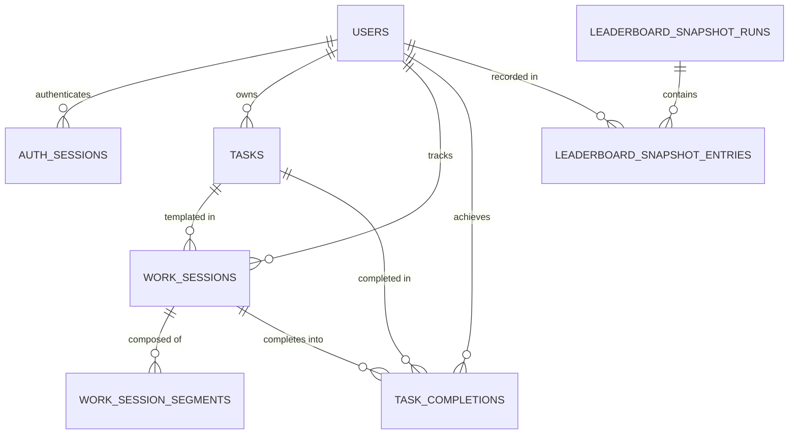

# Data Model Documentation: Focus Tracker

## Overview
Focus Tracker's data architecture is implemented with **Drizzle ORM** for PostgreSQL using the `postgres.js` driver. All primary keys use standard UUIDs (`uuid`), timestamps are stored with time zone in UTC (`timestamptz`), and all dates for streaks, daily totals, and leaderboards are derived in the product timezone (`Asia/Kolkata`).

---

## 1. Entity Relationship Diagram

---

## 2. Table Specifications & Foreign Keys

### 2.1 `users`
Represents user profiles. Service logic strictly restricts registration to a maximum of 4 active user profiles.
- `id` (uuid, PK): Auto-generated random UUID (`defaultRandom()`).
- `display_name` (text, not null): Display name chosen by user.
- `normalized_name` (text, unique, not null): Lowercase, trimmed representation for case-insensitive uniqueness.
- `pin_hash` (text, not null): Scrypt-hashed PIN.
- `is_active` (boolean, not null, default true): Account active status.
- `created_at` (timestamptz, not null, default now()).
- `updated_at` (timestamptz, not null, default now()).

### 2.2 `auth_sessions`
Database-backed revocable session tokens for authentication.
- `id` (uuid, PK): Auto-generated random UUID.
- `user_id` (uuid, FK -> users.id, not null, `ON DELETE CASCADE`): Associated user.
- `token_hash` (text, unique, not null): Cryptographic SHA-256 hash of the cookie token (never store raw session tokens).
- `created_at` (timestamptz, not null, default now()).
- `expires_at` (timestamptz, not null): Absolute expiration timestamp.
- `last_seen_at` (timestamptz, nullable): Rolling activity timestamp.
- **Indexes**:
  - `idx_auth_sessions_user_id`: Fast lookup of all sessions belonging to a user.
  - `idx_auth_sessions_expires_at`: Efficient cleanup of expired sessions.

### 2.3 `tasks` (Reusable Task Templates)
Reusable templates for focused work sessions. A task can be worked on repeatedly; completing a session never deletes or locks the task template.
- `id` (uuid, PK): Auto-generated random UUID.
- `owner_user_id` (uuid, FK -> users.id, not null, `ON DELETE CASCADE`): Owning user profile.
- `title` (text, not null): Task template title.
- `description` (text, nullable): Optional details/notes.
- `planned_duration_seconds` (integer, nullable): Target duration in seconds. If present, indicates countdown timer mode; if null, stopwatch mode.
- `category` (text, nullable): Category tag (e.g. "Engineering", "Writing", "Deep Work"). Null values default to "Uncategorized" in analytics.
- `status` (text, enum: 'active' | 'archived', default 'active', not null): Soft archival status.
- `created_at` (timestamptz, not null, default now()).
- `updated_at` (timestamptz, not null, default now()).
- `archived_at` (timestamptz, nullable): Timestamp when task was archived.
- **Constraints & Checks**:
  - `planned_duration_positive_check`: `planned_duration_seconds IS NULL OR planned_duration_seconds > 0`.
- **Indexes**:
  - `idx_tasks_owner_status`: Composite index on `(owner_user_id, status)` for fast active task filtering.
  - `idx_tasks_owner_updated_at`: Composite index on `(owner_user_id, updated_at)` for sorting recently edited tasks.

### 2.4 `work_sessions`
Represents an individual work session (attempt) on a task.
- `id` (uuid, PK): Auto-generated random UUID.
- `user_id` (uuid, FK -> users.id, not null, `ON DELETE CASCADE`): Owning user.
- `task_id` (uuid, FK -> tasks.id, nullable, `ON DELETE SET NULL`): Reference to task template. If the task is later archived/deleted, historical sessions remain intact.
- `mode` (text, enum: 'countdown' | 'stopwatch', not null): Timer mode.
- `status` (text, enum: 'running' | 'paused' | 'awaiting_decision' | 'completed' | 'stopped', not null).
- `target_duration_seconds` (integer, nullable): Target time for countdown sessions (including extensions).
- `tracked_seconds` (integer, not null, default 0): Accumulated active focus seconds from closed segments. Kept synchronized transactionally.
- `task_title_snapshot` (text, not null): Immutable copy of task title at start time.
- `category_snapshot` (text, nullable): Immutable copy of category at start time.
- `started_at` (timestamptz, not null, default now()): Initial session start time.
- `finished_at` (timestamptz, nullable): When session officially finished (completed or stopped).
- `created_at` (timestamptz, not null, default now()).
- `updated_at` (timestamptz, not null, default now()).
- **Constraints & Checks**:
  - `tracked_seconds_nonnegative`: `tracked_seconds >= 0`.
  - `countdown_target_positive`: Countdown sessions require a positive target: `mode != 'countdown' OR (target_duration_seconds IS NOT NULL AND target_duration_seconds > 0)`.
- **Indexes**:
  - **Partial Unique Index**: `idx_work_sessions_single_running` on `user_id WHERE status = 'running'`. Guarantees a user can have at most one running timer across the entire system. Handled as HTTP 409 conflict.
  - `idx_work_sessions_user_status`: Composite index on `(user_id, status)`.
  - `idx_work_sessions_task_id`: Index on `task_id`.

### 2.5 `work_session_segments`
One row represents one uninterrupted active timer interval. A pause/stop/completion/expiry closes the open segment; resume/extension creates a new segment.
- `id` (uuid, PK): Auto-generated random UUID.
- `work_session_id` (uuid, FK -> work_sessions.id, not null, `ON DELETE CASCADE`): Associated session.
- `started_at` (timestamptz, not null, default now()): Start of continuous focus period.
- `ended_at` (timestamptz, nullable): End of continuous focus period. Null indicates the segment is currently open/running.
- `created_at` (timestamptz, not null, default now()).
- **Constraints & Indexes**:
  - **Partial Unique Index**: `idx_segments_single_open` on `work_session_id WHERE ended_at IS NULL`. Guarantees at most one open segment per work session.
  - `idx_segments_session_started_at`: Composite index on `(work_session_id, started_at)`.

### 2.6 `task_completions`
Records a qualifying task completion event. Exactly one completion record per completed session.
- `id` (uuid, PK): Auto-generated random UUID.
- `user_id` (uuid, FK -> users.id, not null, `ON DELETE CASCADE`): Owning user profile.
- `task_id` (uuid, FK -> tasks.id, nullable, `ON DELETE SET NULL`): Associated task template.
- `work_session_id` (uuid, FK -> work_sessions.id, unique, not null, `ON DELETE CASCADE`): The work session that produced this completion. Unique constraint guarantees zero double completions.
- `task_title_snapshot` (text, not null): Preserves historical task title.
- `category_snapshot` (text, nullable): Preserves historical category.
- `completed_at` (timestamptz, not null, default now()): Exact completion timestamp in UTC.
- `created_at` (timestamptz, not null, default now()).
- **Indexes**:
  - `idx_task_completions_user_completed_at`: Composite index on `(user_id, completed_at)` for rapid streak and daily contribution queries.
  - `idx_task_completions_task_id`: Index on `task_id`.

### 2.7 `leaderboard_snapshot_runs`
Checkpoint executions captured at scheduled slots (`10:00`, `18:00`, `22:00` in Asia/Kolkata).
- `id` (uuid, PK): Auto-generated random UUID.
- `local_date` (text, not null): Calendar date string `YYYY-MM-DD` in Asia/Kolkata.
- `slot` (text, enum: '10:00' | '18:00' | '22:00', not null): Scheduled slot.
- `scheduled_for` (timestamptz, not null): Expected execution time.
- `captured_at` (timestamptz, not null, default now()): Actual execution time.
- `is_delayed` (boolean, not null, default false): Flagged if captured > 15 minutes after scheduled slot.
- `created_at` (timestamptz, not null, default now()).
- **Constraints**:
  - `uniqueIndex('idx_leaderboard_runs_date_slot')` on `(local_date, slot)`: Guarantees idempotent snapshot execution.

### 2.8 `leaderboard_snapshot_entries`
Individual profile records captured during a snapshot run.
- `id` (uuid, PK): Auto-generated random UUID.
- `snapshot_run_id` (uuid, FK -> leaderboard_snapshot_runs.id, not null, `ON DELETE CASCADE`): Parent run.
- `user_id` (uuid, FK -> users.id, not null, `ON DELETE CASCADE`): Profile included in leaderboard.
- `display_name_snapshot` (text, not null): User display name at capture time.
- `focus_seconds_today` (integer, not null, default 0): Accumulated active focus time on `local_date` up to checkpoint.
- `completed_tasks_today` (integer, not null, default 0): Task completions on `local_date` up to checkpoint.
- `focus_seconds_last_7_days` (integer, not null, default 0): Rolling 7-day active focus time.
- `completed_tasks_last_7_days` (integer, not null, default 0): Rolling 7-day task completions.
- `captured_at` (timestamptz, not null, default now()).
- **Constraints & Checks**:
  - Checks for non-negative integers: `focus_seconds_today >= 0`, `completed_tasks_today >= 0`, `focus_seconds_last_7_days >= 0`, `completed_tasks_last_7_days >= 0`.
  - `uniqueIndex('idx_leaderboard_entry_run_user')` on `(snapshot_run_id, user_id)`: Guarantees exactly one entry per user per snapshot run.
