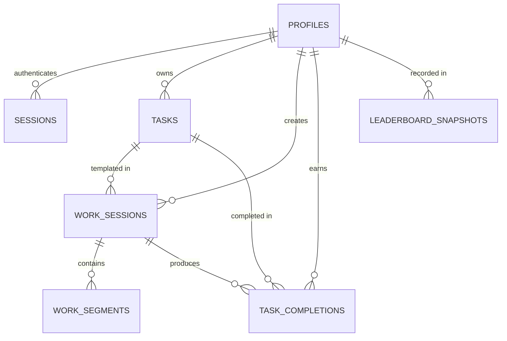

# Data Model Documentation: Focus Tracker

## Overview
The schema is defined in TypeScript using **Drizzle ORM** for PostgreSQL. All primary keys use UUIDs or nanoids (`text` or `uuid`), and timestamps are stored with time zone (`timestamptz`).

---

## 1. Entity Relationship Diagram (Conceptual)

---

## 2. Table Specifications

### 2.1 `profiles`
Represents individual user accounts (maximum 4 registered profiles).
- `id` (text / uuid, PK): Unique profile identifier.
- `display_name` (text, unique, not null): Trimmed, normalized display name (case-insensitive uniqueness via lower index or unique lowercase constraint).
- `pin_hash` (text, not null): Secure scrypt-derived password/PIN hash.
- `created_at` (timestamptz, not null, default now()): Account creation time.
- `updated_at` (timestamptz, not null, default now()): Last updated timestamp.

### 2.2 `sessions`
Database-backed revocable sessions for authentication.
- `id` (text, PK): Random session token (or cryptographic session identifier).
- `profile_id` (text, FK -> profiles.id, not null): The authenticated user profile.
- `token_hash` (text, not null): Hash of session token to prevent database leak compromise.
- `expires_at` (timestamptz, not null): Expiration timestamp (e.g. 30 days rolling).
- `created_at` (timestamptz, not null, default now()): Session creation time.
- `last_active_at` (timestamptz, not null, default now()): Last request timestamp.

### 2.3 `tasks`
Reusable task templates. Completing a task creates a completion record without archiving or locking the task template.
- `id` (text, PK): Unique task identifier.
- `profile_id` (text, FK -> profiles.id, not null): Owner profile.
- `title` (text, not null): Task title.
- `description` (text, nullable): Optional task notes or description.
- `planned_duration_seconds` (integer, nullable): Target duration in seconds. If present, indicates countdown timer mode; if null, indicates stopwatch mode.
- `category` (text, nullable): Category tag (e.g., "Engineering", "Writing", "Deep Work"). Null values default to "Uncategorized" in analytics.
- `is_archived` (boolean, not null, default false): Soft deletion flag to preserve historical integrity.
- `created_at` (timestamptz, not null, default now()).
- `updated_at` (timestamptz, not null, default now()).

### 2.4 `work_sessions`
Represents an individual focus attempt or tracked block.
- `id` (text, PK): Unique work session identifier.
- `profile_id` (text, FK -> profiles.id, not null): Owner profile.
- `task_id` (text, FK -> tasks.id, nullable): Reference to the task template, if originated from one.
- `snapshot_title` (text, not null): Snapshot of task title at session start time.
- `snapshot_category` (text, nullable): Snapshot of task category at session start time.
- `snapshot_planned_duration_seconds` (integer, nullable): Snapshot of planned duration at session start.
- `mode` (text, not null): `'countdown'` | `'stopwatch'`.
- `status` (text, not null): `'running'` | `'paused'` | `'awaiting_decision'` | `'completed'` | `'stopped'`.
- `target_duration_seconds` (integer, nullable): Current target time (countdown initial time + any extensions).
- `started_at` (timestamptz, not null): When session initially started.
- `ended_at` (timestamptz, nullable): When session officially finished (completed or stopped).
- `created_at` (timestamptz, not null, default now()).
- `updated_at` (timestamptz, not null, default now()).

### 2.5 `work_segments`
Tracks continuous active periods of focused work.
- `id` (text, PK): Unique segment identifier.
- `work_session_id` (text, FK -> work_sessions.id, not null): Associated session.
- `profile_id` (text, FK -> profiles.id, not null): Owner profile.
- `started_at` (timestamptz, not null): When this segment began.
- `ended_at` (timestamptz, nullable): When this segment ended (closed on pause, stop, complete, or target reached). If null, this is the currently active segment.
- `created_at` (timestamptz, not null, default now()).

### 2.6 `task_completions`
Records a qualifying task completion event.
- `id` (text, PK): Unique completion identifier.
- `profile_id` (text, FK -> profiles.id, not null): Owner profile.
- `work_session_id` (text, FK -> work_sessions.id, unique, not null): Session that triggered this completion.
- `task_id` (text, FK -> tasks.id, nullable): Task template completed.
- `completed_at` (timestamptz, not null): Actual timestamp in UTC.
- `completed_date_asia_kolkata` (date / text "YYYY-MM-DD", not null): India calendar date derived at completion time.
- `created_at` (timestamptz, not null, default now()).

### 2.7 `leaderboard_snapshots`
Idempotent checkpoint records for daily and rolling 7-day leaderboards.
- `id` (text, PK): Unique snapshot record ID.
- `snapshot_date_asia_kolkata` (date / text "YYYY-MM-DD", not null): Checkpoint calendar date.
- `slot` (text, not null): `'10:00'` | `'18:00'` | `'22:00'`.
- `profile_id` (text, FK -> profiles.id, not null): Profile included in the snapshot.
- `today_focus_seconds` (integer, not null): Focus seconds accrued today up to checkpoint time.
- `today_completions_count` (integer, not null): Task completions today up to checkpoint time.
- `seven_day_focus_seconds` (integer, not null): Rolling 7 calendar day focus seconds.
- `seven_day_completions_count` (integer, not null): Rolling 7 calendar day task completions.
- `captured_at` (timestamptz, not null): Timestamp when snapshot was executed.
- `is_delayed` (boolean, not null, default false): Indicates whether capture occurred > 15 minutes after scheduled slot.
- `created_at` (timestamptz, not null, default now()).

**Constraints & Indexes:**
- Unique Index: `(snapshot_date_asia_kolkata, slot, profile_id)` guaranteeing zero duplicates.
- Foreign Keys with `ON DELETE CASCADE` or `RESTRICT` where appropriate.
- Partial Index on `work_segments(ended_at)` where `ended_at IS NULL` for fast active segment lookups.
